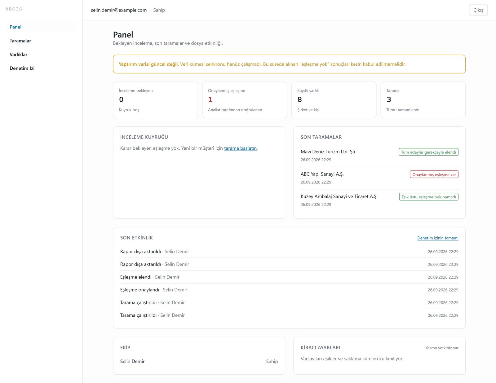
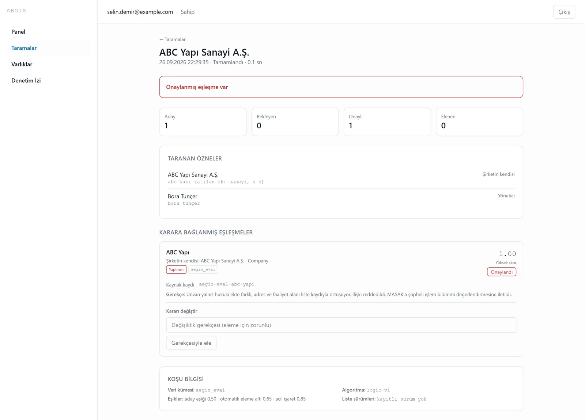
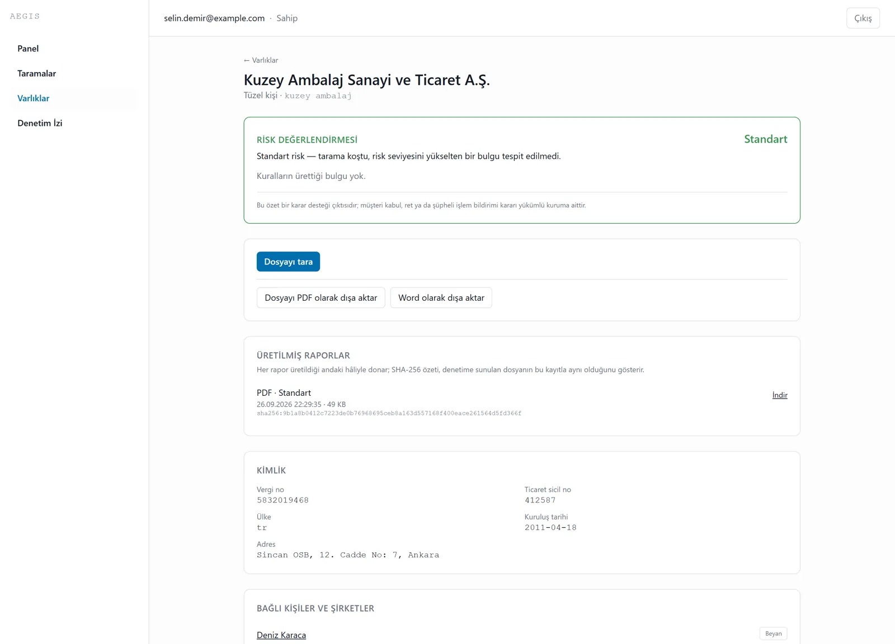
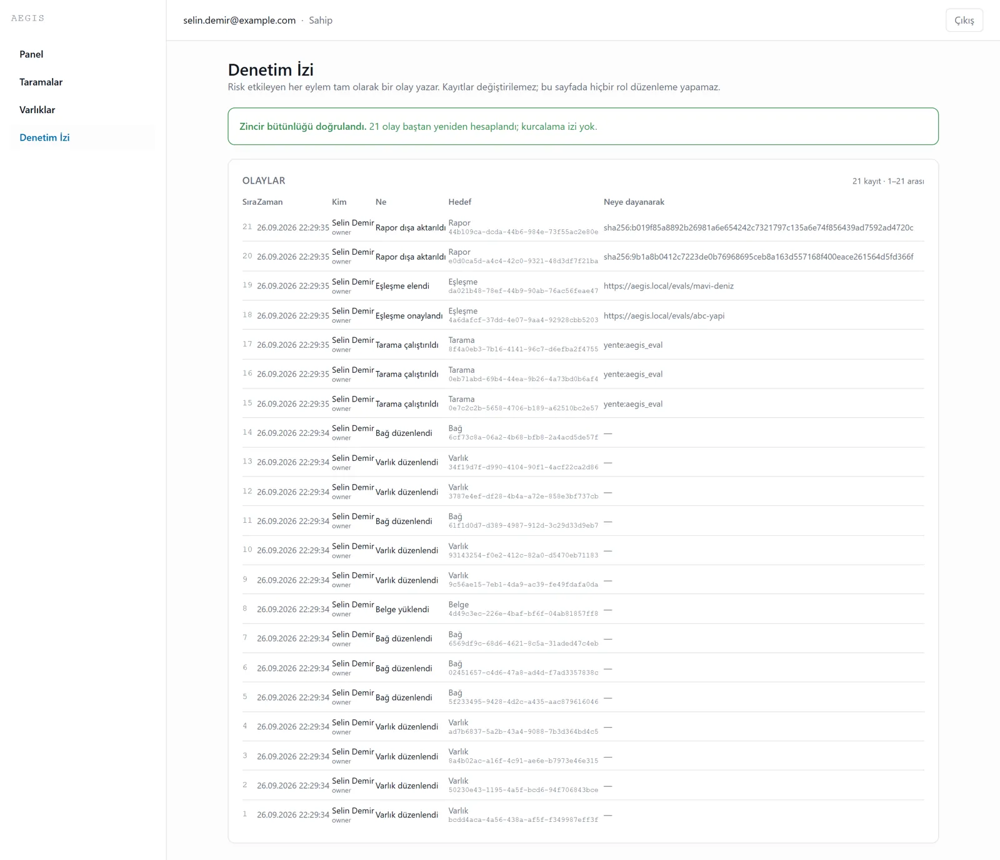
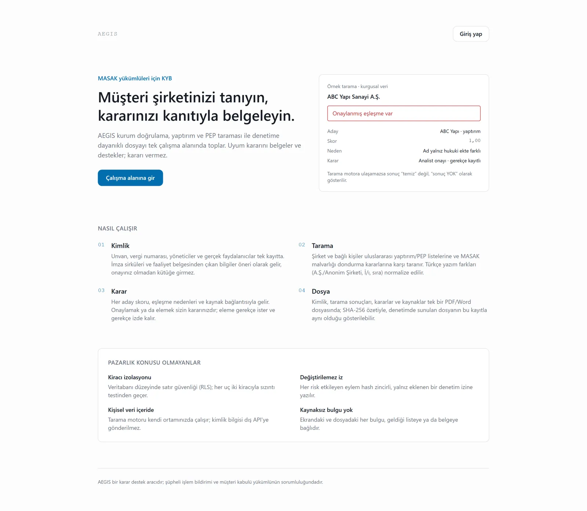

# AEGIS

Multi-tenant B2B SaaS for **KYB / corporate due diligence** in the Turkish MASAK market:
verify a company's identity, screen it and its people against sanctions/PEP/watchlists via
a **self-hosted OpenSanctions yente** instance, and export an audit-proof, source-linked
dossier. AEGIS **documents and supports** the compliance decision; it never makes it.

> Status: **Phase 1 (Core MVP)** — E1.1 platform, E1.3 screening, E1.4 entity registry and
> E1.5 reports are complete; E1.6 (production deploy + pilots) is open. See `docs/ROADMAP.md`;
> conventions and invariants live in `CLAUDE.md`.

| | |
|---|---|
|  |  |
| **Dashboard** — review queue, latest screenings, audit activity | **Screening** — confirmed match with score, reasons, source and rationale |
|  |  |
| **Entity file** — risk verdict, dossier export, extraction proposals | **Audit trail** — hash-chained, verified on every view |
|  | |
| **Landing** | |

## Architecture (Phase 1)

- **API** — FastAPI (async), JWT auth, tenant-resolution, RBAC, OpenAPI
- **Web** — Next.js 16 (App Router) + TypeScript + Tailwind
- **Workers** — Celery + Redis (screening, daily sync, document extraction)
- **Screening** — self-hosted yente 5.5.0 + Elasticsearch 9.4.2 (PII never leaves the env)
- **Data** — PostgreSQL 16 (pooled multi-tenancy via `tenant_id` + **RLS**), Redis, MinIO/S3
- **Deploy** — single-host Docker Compose + Caddy (E1.6); GitHub Actions CI/CD

## Quick start (dev)

```bash
cp .env.example .env            # fill AUTH_SECRET etc.
uv sync                         # Python deps (uv workspace)
pnpm install                    # JS deps (pnpm workspace)

# Bring up Postgres + Redis (+ MinIO), then migrate and run:
docker compose -f infra/compose/docker-compose.yml up -d postgres redis
uv run alembic upgrade head
pnpm run api:dev                # http://localhost:8000  (/docs for OpenAPI)
pnpm run web:dev                # http://localhost:3000
```

Screening services (heavy) are behind a compose profile:
`docker compose -f infra/compose/docker-compose.yml --profile screening up -d`.

## Local demo (end to end)

The demo screens against the **evaluation** yente index (34 fictional reference entities,
`aegis_eval`) instead of the multi-GB production catalogue:

```bash
docker compose -f infra/compose/docker-compose.yml up -d postgres redis minio
docker compose -f infra/compose/docker-compose.evals.yml up -d      # yente :8002 + ES
# .env: YENTE_URL=http://localhost:8002  YENTE_DATASET=aegis_eval
#       FIELD_ENCRYPTION_KEY=$(uv run python -c "from aegis_core.security.encryption import generate_key; print(generate_key())")
uv run alembic upgrade head
uv sync --group extraction        # optional: Docling PDF extraction (~2 GB, PyTorch)
pnpm run api:dev & pnpm run worker:dev & pnpm run web:dev
uv run python scripts/demo_verisi.py
```

`scripts/demo_verisi.py` registers *Anadolu Uyum Danışmanlık A.Ş.* (`selin.demir@example.com`
/ `AegisDemo-2026`) and creates three fictional KYB cases through the real API: a clean
company with officers, a UBO and a signature-circular PDF (Docling → extraction proposals),
a confirmed match (`ABC Yapı Sanayi A.Ş.`) and a dismissed homonym (`Mavi Deniz Turizm Ltd.
Şti.`), then exports two PDF dossiers. No person is ever shown as a sanctions candidate:
the evaluation set's common Turkish names could coincide with real people.

**Windows notes.** Celery's `-B` (embedded beat) is not supported on Windows — run the worker
without it (`uv run celery -A aegis_worker.celery_app:celery_app worker --pool=solo`) and beat
separately if needed. Docling's layout model calls `torch.compile`, which needs MSVC on
Windows; without it set `TORCHDYNAMO_DISABLE=1` for the worker. A failed or skipped extraction
can be re-queued from the entity page (`POST /documents/{id}/extract`).

## Tests

```bash
uv run pytest                   # unit + normalization recall floor (259)
uv run pytest -m integration    # cross-tenant isolation gate, testcontainers (79)
YENTE_TEST_URL=http://localhost:8002 uv run pytest -m screening   # end-to-end recall (36)
```

CI additionally runs ruff, mypy (strict), the OpenAPI drift check, gitleaks, `pip-audit` and
`pnpm audit --prod` (high/critical = red).

## Non-negotiables

Tenant RLS from migration 0001 · append-only audit trail with a tamper-evident hash chain ·
PII never sent to external screening APIs · every finding carries a source reference. See
`CLAUDE.md`.

## How it was built

AEGIS was built with Claude Code as a pair, in one epic per commit (E1.1 → E1.5), against a
written roadmap with numbered decision revisions (R1–R7) and ADRs. The model wrote most of the
code; what made it trustworthy is that every compliance promise is a **test gate**, not a
sentence: two tenants must leak nothing on every endpoint (RLS + app role), the audit chain
must re-verify, a Turkish evaluation set must hit 100 % recall through the real screening
engine, and a failed screening must never render as "clean".

The 2026-09 audit ran the product end to end for the first time and fixed what only a real
run shows: two critical Next.js advisories (one an unauthenticated RCE) and 11 high ones in
production dependencies (plus a `pip-audit` step that could never fail), a dismissed high-score candidate that kept the screening in
"urgent review" forever, failed document extractions that could never be retried, a worker
that could not run on the owner's Windows machine, a gitleaks false positive that had kept CI
red since 2026-08-08, and a mobile layout that overflowed on every page.
