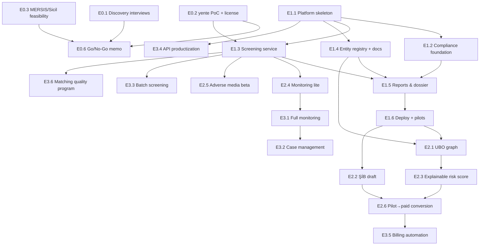

# AEGIS — Delivery Roadmap (Solo Developer)

**Source of truth:** `AEGIS_Proje_Plani.docx` v1.0 (July 2026)
**Roadmap version:** 1.0 · 2026-07-21
**Audience:** Scryne, sole engineer and operator

---

## 1. Architecture & Constraint Summary (alignment check)

This roadmap is built on the following understanding of the plan. If any point here is
wrong, the roadmap needs revision before execution.

**Product.** Multi-tenant B2B SaaS for KYB / corporate due diligence: verify a company's
identity and ownership (UBO), screen it and its key people against sanctions/PEP/watchlists,
scan adverse media, produce an explainable risk score with a source-linked, audit-proof
dossier, and monitor the relationship continuously. AEGIS **documents and supports** the
compliance decision; it never makes it (liability positioning is contractual and UI-level).

**Anchor segment.** SMMM/YMM and independent audit offices in Turkey (MASAK-obligated,
short sales cycle, manual today). Adjustable hypothesis — Phase 0 validates it.

**Architecture.**

| Layer | Choice |
|---|---|
| Frontend | Next.js (App Router) + TypeScript + Tailwind, SSR dashboard |
| API | FastAPI (async), JWT auth, tenant resolution, rate limiting, OpenAPI |
| Async jobs | Celery + Redis (screening, monitoring, batch, document processing) |
| Screening engine | **Self-hosted OpenSanctions `yente`** (+ Elasticsearch index) — PII never leaves our environment |
| AI layer | LangGraph agents + Claude API behind a model-agnostic abstraction; pgvector for embeddings |
| Data | PostgreSQL 16 (single DB: relational + JSONB + pgvector; recursive CTE for ownership graph, Apache AGE only if later justified), Redis, S3-compatible object storage |
| Multi-tenancy | Pooled model: `tenant_id` on every table + PostgreSQL **RLS** enforced at DB level; RBAC (Owner, Compliance Officer, Analyst, Read-only Auditor) |
| Data model | FollowTheMoney (FtM)-aligned entities: Entity, Relationship, Screening, RiskAssessment, Case, AuditEvent |
| Entity resolution | Normalization (Turkish chars, legal-form suffixes) → candidate generation (deterministic keys + fuzzy) → scoring + human-in-the-loop |
| Deployment | Docker Compose on a single host; GitHub Actions CI/CD |

**Primary constraints.**

1. **Solo developer** — minimize operational surface: one database, few services,
   boring deployments, automation from day one.
2. **KVKK / data locality** — customer PII never sent to external screening APIs
   (hence self-hosted yente); Turkey-hosted data option; ≥5-year retention with planned
   disposal; append-only audit trail from the first migration.
3. **Reuse the proven TenderIQ stack** — FastAPI, Celery/Redis, pgvector, Docling,
   RLS multi-tenancy (FabrikaOS pattern). New engineering risk is concentrated in
   **entity-resolution quality** and the **screening engine setup**, nowhere else.
4. **Value before infrastructure** — every phase ends in something demoable or sellable.

**Repo conventions.** The repository currently contains only the plan document — no code,
no git history, no SKILL.md or CLAUDE.md conventions. This roadmap therefore assumes a
fresh monorepo (layout proposed in Phase 1, task E1.1-1) and that TenderIQ conventions
(linting, project layout, migration style) are imported with the skeleton. When the repo
is initialized, add a `CLAUDE.md`/`SKILL.md` capturing those conventions so future work
follows them.

---

## 2. Phase Overview

| Phase | Name | Duration | Shippable outcome | Sellable? |
|---|---|---|---|---|
| 0 | Validation & Feasibility | 2–3 wk | Go/no-go memo + working yente PoC + throwaway demo used in interviews | No (demoable) |
| 1 | Core MVP | 7–9 wk | Live pilot product: company profile + sanctions/PEP screening + audit-proof report, deployed, 3–5 pilot tenants | **Yes — first sellable increment** |
| 2 | Differentiation & First Revenue | 6–8 wk | UBO graph, ŞİB draft, explainable risk score, monitoring-lite, adverse-media beta; **first paying customers** | Yes (first revenue) |
| 3 | Scale & Revenue Engine | 8–10 wk | Full continuous monitoring, case management, batch, public API + webhooks, automated billing | Yes (recurring revenue) |
| 4 | Expansion | ongoing | EU/UK API-first entry, SSO/OIDC, white-label (demand-gated), AGE migration (if needed) | Yes |

Cumulative timeline (solo, full-time): first live pilot ≈ **week 10–12**; first revenue ≈
**week 13–16**; recurring-revenue engine complete ≈ **week 23–30**.

---

## 3. Critical Path & Dependency Map

**Critical path** (a slip here slips the whole delivery):

```
yente PoC + license quote (E0.2)
  → platform skeleton w/ RLS + audit trail (E1.1, E1.2)
    → screening service (E1.3)
      → report & dossier export (E1.5)
        → production deploy + pilots live (E1.6)
          → UBO graph (E2.1) + ŞİB draft (E2.2)
            → pilot→paid conversion (E2.6)
              → full monitoring (E3.1) + billing automation (E3.5)
```

**Off the critical path** (schedule flexibly, in parallel or gaps): discovery interviews
(E0.1, calendar-bound — start day 1), local data-source feasibility (E0.3), adverse-media
beta (E2.5), case management (E3.2), batch screening (E3.3), matching quality program (E3.6).



**Hard sequencing rules:**

- RLS + `tenant_id` + append-only audit trail go into the **first migration**. Retrofitting
  either onto live pilot data is the most expensive mistake available in this project.
- Screening (E1.3) before reports (E1.5) — the report is a projection of screening output.
- No paid conversion (E2.6) before ŞİB draft + risk score exist; those are what pilots pay for.
- Full monitoring (E3.1) builds on monitoring-lite (E2.4) diff machinery — don't build twice.
- MERSIS integration is **gated on E0.3 findings** and is never on the critical path (see Revision R1).

---

## 4. Earliest Sellable / Demoable Increment

- **Demoable: end of Phase 0 (~week 3).** Throwaway demo — a thin UI over self-hosted
  yente showing live sanctions/PEP hits on Turkish names — used *inside* discovery
  interviews to convert abstract interest into pilot commitments.
- **Sellable: end of Phase 1 (~week 10–12).** Screening + verified company profile +
  exportable, source-linked, audit-proof report on real tenant data. This is already a
  product an SMMM office would pay for; pilots run free through Phase 1 to buy accuracy
  feedback and case studies.
- **First cash: early Phase 2 (~week 13–16).** Conversion via hosted checkout links +
  manual entitlements — deliberately **not** blocked on a billing system (Revision R5).

---

## 5. Decision Revisions

Deviations from the plan. Everything not listed here follows the plan as written.

### R1 — M1 corporate verification must not depend on MERSIS in Phase 1
- **Original:** M1 (registry-backed corporate verification) is a Phase 1 MVP module, with
  MERSIS/Ticaret Sicil access "to be validated in Phase 0."
- **Revised:** Phase 1 M1 ships with three data paths that are certain to work: manual
  entry, **document extraction** (imza sirküleri / faaliyet belgesi via Docling), and
  Ticaret Sicil Gazetesi public lookups. MERSIS integration becomes a separate,
  feasibility-gated epic scheduled only after E0.3 confirms a lawful, stable access method.
- **Reasoning:** A solo developer cannot put an unverified government data source on the
  MVP critical path. The plan itself rates this risk "High." Discrepancy flagging (the
  MASAK-relevant feature) works identically against document-extracted data.
- **Trade-off:** Phase 1 verification is less automated than the plan implies. Accepted:
  pilots' current baseline is fully manual, so value is still dramatic, and the accountant
  workflow (documents in hand) matches the document path anyway.

### R2 — Docling document extraction moves from Phase 2 to Phase 1
- **Original:** Document upload → auto-extraction is a Phase 2 differentiator.
- **Revised:** Basic extraction for two document types (imza sirküleri, faaliyet belgesi)
  ships in Phase 1 as part of M1.
- **Reasoning:** The plan rates it "Low effort" because it ports from TenderIQ, and R1
  makes it the primary structured-data entry path. Highest reuse-to-value move available.
- **Trade-off:** Phase 1 grows ~1 week. Contained by hard-limiting scope to two document
  types with user-confirmed suggestions (no auto-commit to the entity graph).

### R3 — Monitoring-lite pulled into Phase 2; full monitoring stays in Phase 3
- **Original:** Continuous monitoring is entirely Phase 3.
- **Revised:** Phase 2 ships monitoring-lite: nightly OpenSanctions re-sync → re-screen
  watched entities → diff → email/in-app alert. Ownership-change detection, alert
  workflow, EDD escalation, and per-entity monitoring billing remain Phase 3.
- **Reasoning:** Once dataset sync + screening exist (Phase 1), the diff-and-alert loop is
  ~1 week of work and is the product's stickiest feature. Pilots who receive an alert
  about their own client don't churn, which directly de-risks the Phase 2 paid conversion.
- **Trade-off:** Phase 2 scope +1 week and monitoring is initially sanctions-diff-only.
  Accepted; the recurring-revenue *machinery* (billing per watched entity) still lands in
  Phase 3 as planned.

### R4 — Embedding-based candidate generation deferred out of the core ER pipeline
- **Original:** Candidate generation = deterministic keys + fuzzy names + **pgvector
  embedding similarity**, from the start.
- **Revised:** Phase 1–2 entity resolution uses deterministic keys (vergi no, MERSIS no,
  LEI) + Turkish-aware normalization + `pg_trgm` fuzzy matching, and delegates
  sanctions-side matching to yente's built-in scorer. Embedding-based candidates are
  introduced in Phase 3 (E3.6) only where the precision/recall dashboard shows deterministic +
  fuzzy is measurably insufficient. pgvector still ships in Phase 2 — for adverse media,
  where semantic similarity is genuinely required.
- **Reasoning:** yente already solves the hard fuzzy-matching problem against watchlist
  data — duplicating it internally is redundant work. An embedding pipeline without a
  labeled evaluation set is untunable; the HITL review queue must first *produce* that
  labeled set. Classic solo-dev trap avoided: building sophistication before measurement.
- **Trade-off:** Possible recall misses on hard Turkish name variants in early phases.
  Mitigated by human review of borderline scores (every miss becomes labeled training
  data) and by an aggressive transliteration/normalization table from day one.

### R5 — Charge customers before building billing
- **Original:** Billing/subscription infrastructure arrives in Phase 3, implicitly gating
  revenue on it.
- **Revised:** Phase 2 converts pilots to paid via hosted checkout links (iyzico or
  PayTR — validated in Phase 0) + manually provisioned entitlements + a subscription
  agreement containing the decision-support liability clause. Phase 3 automates metering,
  tiers, overage, and the monitoring add-on.
- **Reasoning:** "Earliest sellable increment" is the prime directive. At 3–10 customers,
  manual invoicing costs minutes per month; a billing engine costs weeks. Willingness-to-pay
  is also the single most valuable Phase 2 learning signal.
- **Trade-off:** Brief manual-ops period and possible entitlement drift. Trivial at pilot
  scale; automated before scale in Phase 3.

### R6 — No Kubernetes on this roadmap
- **Original:** Docker Compose → Kubernetes as load grows.
- **Revised:** Single-host Docker Compose (VPS with a Turkey data-center option) with
  Caddy/Traefik TLS, automated backups, and health-check-driven restarts. Scaling path if
  ever needed: bigger host → second host splitting workers/Elasticsearch from API/DB.
  Kubernetes is removed from the roadmap; revisit only on concrete scale or enterprise
  compliance signals.
- **Reasoning:** K8s is the largest avoidable operational surface a solo operator can
  adopt. The workload (hundreds of small tenants, async-heavy) fits one well-sized host
  for the entire roadmap horizon.
- **Trade-off:** A future enterprise deal demanding orchestrated HA would need migration
  work then. Correct trade for a solo operator now.

### R7 — White-label demoted from Phase 3 to demand-gated Phase 4
- **Original:** White-label depth in Phase 3; theme abstraction "designed from the start."
- **Revised:** Phase 1 only avoids hardcoded branding (design tokens / CSS variables —
  near-zero cost). Actual white-label (custom domains, logos, sub-tenant hierarchies)
  is built in Phase 4 only when a signed MSSP/chamber/software partner exists.
- **Reasoning:** White-label without a committed partner is speculative inventory, and
  sub-tenant hierarchies complicate the RLS model — the one place complexity is dangerous.
- **Trade-off:** A surprise partner would wait a few weeks. Acceptable; the design tokens
  keep that work bounded.

### R8 — Adverse media becomes a time-boxed, feature-flagged beta at the end of Phase 2
- **Original:** M4 AI adverse media is a co-equal Phase 2 deliverable.
- **Revised:** Phase 2 sequence is UBO → ŞİB → risk score → monitoring-lite →
  **then** adverse media, time-boxed to 2 weeks, shipped behind a feature flag as beta,
  with precision measured on a labeled set before it influences the risk score.
- **Reasoning:** It's the plan's highest-effort, highest-uncertainty feature (Turkish news
  API coverage unproven, false-positive stakes high), while ŞİB draft + UBO are what the
  anchor segment demonstrably pays for. If the time-box busts, Phase 2 still converts
  pilots to revenue.
- **Trade-off:** Adverse media matures later (Phase 3 hardening via E3.6). Accepted — a
  wrong adverse-media hit in a compliance product is worse than a "beta" label.

### R9 — Phase 0 gains a throwaway interview demo
- **Original:** Phase 0 = interviews + feasibility + naming only.
- **Revised:** Add a 2–3 day throwaway demo (thin UI over the yente PoC, seeded with
  recognizable Turkish screening cases) used in discovery interviews. Explicitly
  disposable — not the seed of the production codebase.
- **Reasoning:** "Would you pay for this?" against a live screen yields decisively better
  signal than against a description, and it doubles as the yente PoC acceptance test.
- **Trade-off:** 2–3 days of discarded code. Cheap insurance on the product's biggest
  assumption (segment/pricing).

**Minor notes (not decision changes):** pin Next.js to the current stable major at
Phase 1 start ("14" in the plan reflects TenderIQ vintage); yente requires an
Elasticsearch/OpenSearch sidecar — accounted for in the ops footprint (E0.2/E1.3).

---

## 6. Phase 0 — Validation & Feasibility (2–3 weeks)

**Objective:** Kill or confirm the three assumptions the product stands on — segment pain
& willingness to pay, screening-engine feasibility incl. licensing cost, and local data
access — before writing production code.

**Shippable/demoable outcome:** A go/no-go memo backed by 10–15 interviews and 3–5 pilot
commitments; a working self-hosted yente instance; a throwaway demo; a decided name and
licensing budget.

### Epics & tasks

**E0.1 — Customer discovery** *(M · spread across all 3 weeks · calendar-bound: start day 1)*
- [ ] Write a discovery script: current manual KYB/MASAK workflow, time per file, tools used, audit anxiety, price anchoring (hours saved, not TL)
- [ ] Source 10–15 SMMM/YMM & audit-office interviewees (chambers, LinkedIn, referrals)
- [ ] Run interviews; log structured notes per interview (pain, workflow, price signal)
- [ ] Secure 3–5 written pilot commitments (free pilot in exchange for real dossiers + feedback + case-study rights)
- [ ] If segment fails validation, run 3–5 interviews with fallback segment (mid-size companies doing supplier onboarding) before the go/no-go memo

**E0.2 — Screening feasibility PoC (critical path)** *(M · ~4–6 days)*
- [ ] Stand up yente + Elasticsearch via Docker Compose locally; load the OpenSanctions default dataset
- [ ] Verify dataset update mechanism (delta sync) and measure sync duration + disk/RAM footprint
- [ ] Build a Turkish test set (30–50 cases): transliteration variants, ı/i casing, legal-form suffixes, old/new company titles, partial names; record match/miss + scores
- [ ] Measure match latency under burst (batch of 100 queries)
- [ ] Request OpenSanctions commercial license quote; document cost per tier → feeds pricing model
- [ ] Locate MASAK asset-freeze lists; confirm format and that they can be injected as a custom yente/FtM dataset

**E0.3 — Local data-source feasibility** *(M · ~4–5 days, parallelizable with E0.1 gaps)*
- [ ] MERSIS: enumerate access options (official API/protocol, e-Devlet, Ticaret Bakanlığı agreements); document lawful basis, cost, stability; verdict: integrate / defer / drop
- [ ] Ticaret Sicil Gazetesi: test programmatic query + extraction on 10 real companies; document robustness and terms of use
- [ ] GLEIF LEI API: smoke-test lookup + enrichment (open data, low risk)
- [ ] News/media source scan for adverse media (candidates: Event Registry, GDELT, targeted CSE): Turkish coverage, cost, terms → shortlist for Phase 2
- [ ] Written legal-usage summary per source (feeds KVKK processing inventory in Phase 1)

**E0.4 — Throwaway interview demo (per R9)** *(S · 2–3 days, hard time-box)*
- [ ] Thin UI over yente: input name/company → matches with scores and "why matched" features
- [ ] Seed with recognizable Turkish screening cases for demo effect
- [ ] Use in every interview from week 2 onward; log reactions in E0.1 notes

**E0.5 — Name & brand** *(S · 1–2 days)*
- [ ] Trademark search for "AEGIS" (crowded class) + 2–3 alternatives; check .com/.com.tr availability
- [ ] Decide final name; register domain

**E0.6 — Go/no-go memo** *(S · 1 day)*
- [ ] One-pager: segment verdict, pricing hypothesis (anchored to hours saved), data-access verdicts (esp. MERSIS gate for R1), license budget, pilot roster, updated Phase 1 scope

### Technical setup introduced
Local Docker environment; yente + Elasticsearch (PoC-grade); no production infra yet.

### Dependencies
None external. E0.2 gates E1.3; E0.3 gates the MERSIS decision (R1); E0.1 gates everything commercially.

### Exit criteria
- ≥10 interviews done; segment/pricing hypothesis explicitly confirmed or pivoted
- 3–5 pilot commitments in writing
- yente PoC: Turkish test set results documented; latency < 2s/query; sync mechanism proven
- OpenSanctions license cost known and fits the pricing model
- MERSIS verdict recorded; Ticaret Sicil Gazetesi extraction proven or consciously deferred
- Name decided; go/no-go memo written — **and the answer is go**

### Effort: **2–3 weeks total** (interviews are the calendar constraint; technical tasks fill the gaps)

### Phase risks
| Risk | Mitigation |
|---|---|
| Interviews hard to source → phase drags | Start outreach on day 1; run technical tasks in parallel; cap phase at 3 weeks and proceed with ≥8 interviews if signal is consistent |
| OpenSanctions license too expensive for KOBİ pricing | Get quote in week 1; if prohibitive, model pass-through per-query pricing before go/no-go |
| MERSIS has no viable lawful access | Already de-risked by R1 — MVP doesn't depend on it; record verdict and move on |
| Demo becomes "the product" prematurely in prospects' minds | Frame as prototype in interviews; keep code disposable |

---

## 7. Phase 1 — Core MVP (7–9 weeks)

**Objective:** Ship the first sellable increment: a deployed, multi-tenant, KVKK-conscious
product where a pilot office creates a company profile, screens it and its people against
sanctions/PEP/watchlists, and exports an audit-proof, source-linked report.

**Shippable outcome:** 3–5 pilot tenants live on production, running real files;
time-per-file measured against their manual baseline.

### Epics & tasks

**E1.1 — Platform skeleton from TenderIQ (critical path)** *(L · ~2 weeks)*
- [ ] Initialize monorepo + git: `api/` (FastAPI), `web/` (Next.js), `workers/` (Celery), `infra/` (compose, deploy), `docs/`; import TenderIQ lint/format/test conventions; write `CLAUDE.md` capturing them
- [ ] Port FastAPI skeleton: settings, async SQLAlchemy + Alembic, error handling, structured logging (JSON, request-id)
- [ ] Auth: JWT access+refresh, password reset, tenant resolution middleware (token claim → `SET app.tenant_id` per request/connection)
- [ ] **Migration 0001**: tenants, users, roles + `tenant_id` on every tenant-scoped table + **RLS policies enabled from the first migration**
- [ ] RBAC: Owner, Compliance Officer, Analyst, Read-only Auditor; permission dependency for FastAPI routes
- [ ] **Automated cross-tenant isolation test harness** (two seeded tenants; assert zero leakage across every endpoint and direct SQL under app role) — runs in CI on every push
- [ ] Celery + Redis wiring, one demo task, Celery beat scaffold; idempotent job pattern + retry policy as shared utilities
- [ ] Next.js app shell: auth flow, tenant-aware layout, role-gated navigation, design tokens (no hardcoded branding, per R7)
- [ ] Docker Compose dev environment (api, web, worker, beat, postgres, redis, elasticsearch, yente, minio)
- [ ] GitHub Actions CI: lint + typecheck + tests + image build on every push
- [ ] Sentry (api + web) and basic uptime check

**E1.2 — Compliance foundation** *(M · ~1 week — before any pilot data exists)*
- [ ] `audit_events` table: append-only via `REVOKE UPDATE/DELETE` from app role + BEFORE trigger raising on mutation; fields: actor, tenant, action, object, source reference, timestamp; optional hash chain for tamper evidence
- [ ] Audit middleware/helper so services emit events uniformly; every risk-affecting action (screening run, match confirm/dismiss, report export, entity edit) writes one
- [ ] Retention scaffolding: `retention_until` on documents/dossiers (≥5 years post-relationship); scheduled disposal job stub (execution activates later; schema now)
- [ ] Encryption: TLS everywhere; at-rest = encrypted volumes + pgcrypto for sensitive columns (national IDs); secrets via SOPS/age or Docker secrets — never in git
- [ ] KVKK artifacts v1: aydınlatma metni, data-processing inventory (from E0.3 legal summaries), VERBİS registration prep, DPA template for pilot agreements
- [ ] Pilot agreement template incl. decision-support liability clause (per plan §8.3)

**E1.3 — Screening service — M3 (critical path)** *(L · ~2 weeks)*
- [ ] Production-grade yente + Elasticsearch in Compose: resource limits, health checks, restart policy
- [ ] Celery beat job: daily OpenSanctions delta sync; freshness metric + staleness alert (>24h)
- [ ] Inject MASAK asset-freeze lists as custom FtM dataset; automate refresh
- [ ] Turkish normalization module (shared, heavily unit-tested): İ/ı-correct casefolding, transliteration table, legal-form suffix stripping (A.Ş., Ltd. Şti., San. ve Tic. …), whitespace/punctuation canonicalization — built against the E0.2 test set
- [ ] `POST /screen`: normalize → yente match (entity + directors/UBOs) → persist `Screening` + `MatchCandidate` rows (score, matched features, dataset, source URL)
- [ ] Match review workflow (HITL): pending / confirmed / dismissed states, threshold config (auto-clear low, auto-flag high, review band between); every decision → audit event **and label store** (feeds E3.6 evaluation set, per R4)
- [ ] Screening UI: run screening from entity page, results with score + "why matched" features, review actions
- [ ] Sync-path performance: single-entity screening summary < 30s (plan NFR); deep runs async via Celery

**E1.4 — Entity registry & verification — M1 + Docling (per R1/R2)** *(L · ~1.5–2 weeks)*
- [ ] FtM-aligned schema: `Entity` (person/company; vergi no, MERSIS no, LEI as deterministic identifiers), `Relationship` (ownership %, control, officer, family), provenance on every attribute (source + timestamp)
- [ ] Company profile CRUD: manual entry of unvan, vergi no, address, officers, declared shareholders
- [ ] Document upload → S3-compatible storage → Docling extraction (imza sirküleri, faaliyet belgesi only) → suggested officers/owners as proposals requiring user confirmation before entering the graph
- [ ] Ticaret Sicil Gazetesi integration per E0.3 verdict: automated lookup if proven, else guided manual attach with source reference
- [ ] GLEIF LEI enrichment for companies with an LEI
- [ ] Discrepancy flagging: declared vs. extracted/registry data mismatches surfaced on profile + report (MASAK suspicious-transaction precondition)
- [ ] Internal entity resolution v1 (per R4): deterministic identifier match + normalized-name `pg_trgm` similarity → merge-or-create with review on ambiguity

**E1.5 — Reports, risk summary & dossier — M5 basic** *(M · ~1 week)*
- [ ] Rule-based risk summary v1 (transparent, no ML): confirmed sanctions hit → High; PEP → Elevated; unresolved discrepancies → flag; each with plain-language rationale
- [ ] Due diligence dossier export (PDF via HTML template, Word via python-docx): profile, screening results incl. dismissed-with-reason matches, discrepancies, source references, run timestamps + dataset versions
- [ ] Audit-trail viewer (read-only, auditor role): who/what/when/on-what-basis
- [ ] Dossiers stored under retention policy with hash for integrity evidence

**E1.6 — Production deploy & pilot onboarding (critical path)** *(M · ~1 week)*
- [ ] Select VPS with Turkey data-center option (KVKK locality); provision single host
- [ ] Production Compose + Caddy/Traefik (auto-TLS); GitHub Actions deploy job (build → push → `compose up`) — one-command deploy from day one
- [ ] Automated nightly Postgres backups + object storage copy to a second location; **restore drill performed once before pilots**
- [ ] Health checks + uptime alerting to phone
- [ ] Tenant provisioning CLI (create tenant + owner + send invite)
- [ ] Onboard 3–5 pilots: Turkish quick-start guide, kickoff call each, signed pilot agreement + DPA
- [ ] Feedback loop: weekly check-ins; in-app feedback link; measure time-per-file vs. manual baseline from E0.1

### Technical setup introduced
Monorepo + CI/CD; production single-host Docker Compose (api, web, workers, beat,
Postgres 16, Redis, Elasticsearch + yente, MinIO/S3, Caddy); Sentry; backups + restore
drill; secrets management.

### Dependencies
E0.2 (yente proven) → E1.3. E1.1 precedes everything; E1.2 before any pilot data;
E1.3 + E1.4 before E1.5; E1.5 before E1.6. E1.4's gazette task depends on E0.3 verdict.

### Exit criteria (definition of done)
- Cross-tenant isolation suite green in CI; manual spot-check on prod
- Audit trail proven append-only (mutation attempts fail at DB level); risk-affecting actions all emit events
- A pilot completes a real end-to-end file: profile → screen → review → export, unassisted
- Screening summary < 30s; dataset freshness < 24h with staleness alerting
- Turkish name test set (E0.2) passes at documented target rates through the API path
- ≥3 pilots active on production; time-per-file measured (target: hours → minutes)
- Restore drill documented; deploy is one command

### Effort: **7–9 weeks** (E1.1 ~2w · E1.2 ~1w · E1.3 ~2w · E1.4 ~1.5–2w · E1.5 ~1w · E1.6 ~1w)

### Phase risks
| Risk | Mitigation |
|---|---|
| TenderIQ port is messier than expected | Time-box E1.1 to 2 weeks; port patterns, not code, where code resists; cut scope from E1.4 gazette task first, never from RLS/audit |
| Turkish matching accuracy disappoints on real pilot data | E0.2 test set as regression suite; review band catches borderline cases; every HITL decision becomes a labeled example |
| Pilot inertia (committed but not using) | Weekly check-ins; concierge-onboard their first 5 real files personally; pick pilots with active MASAK anxiety in E0.1 |
| Solo dev drowning in ops during pilot | R6 posture (one host, few services); alerting to phone; weekly maintenance window communicated to pilots |
| Scope creep from pilot feature requests | Log everything, build nothing off-roadmap in Phase 1; feed requests into Phase 2/3 planning |

---

## 8. Phase 2 — Differentiation & First Revenue (6–8 weeks)

**Objective:** Ship the differentiators the anchor segment pays for (UBO graph, ŞİB draft,
explainable risk score), make the product sticky (monitoring-lite), and convert pilots to
paying customers.

**Shippable outcome:** First revenue. Pilots on paid plans using UBO extraction and ŞİB
drafts on real files; monitoring alerts firing on real dataset changes.

**In-phase sequence (per R8):** E2.1 → E2.2 → E2.3 → E2.4 → E2.6 (convert as soon as
value justifies it) → E2.5 last, time-boxed.

### Epics & tasks

**E2.1 — UBO / ownership graph — M2 (critical path)** *(L · ~2 weeks)*
- [ ] Ownership edges with percentage + type (direct/indirect/control) on `Relationship`
- [ ] UBO computation: Postgres recursive CTE from target company through ownership chains; effective-percentage multiplication across layers; ≥25% threshold persons; **cycle/circular-ownership detection** with explicit surfacing
- [ ] Unresolvable-chain handling (foreign parent, missing data): report "UBO not determinable — reason", never silently absorb (a MASAK-relevant signal in itself)
- [ ] UBO computation snapshots persisted with inputs + timestamp (audit: "what did we know when we decided")
- [ ] Interactive graph UI (React Flow or Cytoscape): pan/explore, UBO paths highlighted, % on edges, click-through to person entities + their screening status
- [ ] Docling extension: extract shareholding tables from ortaklık yapısı documents → proposed ownership edges w/ confirmation
- [ ] Auto-trigger screening for newly identified UBOs (M2→M3 integration)
- [ ] Test fixtures: layered structures, cross-holdings, circular ownership, exact-25% boundary

**E2.2 — ŞİB draft generation (critical path)** *(S–M · ~3–5 days)*
- [ ] Model the current MASAK ŞİB form; template with prefill from dossier (identity, UBO findings, discrepancies, screening hits)
- [ ] Export as editable document; status tracking (draft/exported) + audit events
- [ ] Prominent UI + document disclaimer: official submission to MASAK is the obligated party's responsibility (per plan §3.3)
- [ ] Validate output with 2–3 pilot compliance officers against a real filing

**E2.3 — Explainable risk score — M5 mature** *(M · ~1 week)*
- [ ] Weighted factor model over structured findings only (per plan §6.6: LLM output never scores directly): sanctions/PEP status, UBO determinability, discrepancy count, entity type/jurisdiction flags
- [ ] Every factor renders reason + link to underlying evidence (screening record, registry data, document)
- [ ] Fixed global weights v1 (documented rationale); per-tenant tuning deferred until customers ask
- [ ] Score history timeline per entity; recompute triggers on data change
- [ ] Dossier export upgraded: score breakdown page with per-factor evidence references

**E2.4 — Monitoring-lite (per R3)** *(M · ~1 week)*
- [ ] Watch flag per entity (`monitored: bool`, per-tenant)
- [ ] Nightly post-sync job: re-screen watched entities → structural diff vs. last confirmed results (new/changed/removed matches)
- [ ] Alert on material diff: in-app notification + email; links to review workflow; audit event
- [ ] Alert list UI with acknowledge action (full case-management routing comes in Phase 3)
- [ ] Synthetic diff test (injected dataset change produces exactly one correct alert)

**E2.5 — Adverse media beta — M4 (per R8)** *(L · hard 2-week time-box, feature-flagged)*
- [ ] Integrate the E0.3-shortlisted news source; candidate retrieval by normalized names + aliases
- [ ] pgvector embeddings for relevance ranking of candidates (embeddings' first production use, per R4)
- [ ] LangGraph pipeline: disambiguation ("is this actually this person/company?") → negativity classification → evidence-sentence extraction; every claim carries source URL + quote
- [ ] Model-agnostic LLM abstraction layer (Claude API first; provider-swappable interface) — shared with Phase 3+ AI features
- [ ] HITL confirmation before any finding attaches to the dossier; beta-labeled UI section; **excluded from risk score** until E3.6 precision measurement clears it
- [ ] Labeled evaluation set (~50 cases from pilot entities); measure precision/recall; publish internal accuracy note
- [ ] If time-box busts: ship retrieval + manual triage only; move LLM pipeline to Phase 3

**E2.6 — Pilot → paid conversion (per R5)** *(S–M · ~3–5 days + calendar time)*
- [ ] Pricing v1 from Phase 0 signals: base subscription + included query quota; overage and monitoring add-on priced but manually enforced
- [ ] Payment rails: iyzico or PayTR hosted checkout/links (decide via E0.3-style quick validation); manual invoicing acceptable for first customers
- [ ] Subscription agreement: liability positioning, KVKK/DPA, 5-year retention terms
- [ ] Manual entitlements: plan field per tenant + quota check middleware (hard infra for metering deferred to E3.5)
- [ ] Convert pilots (target ≥2–3 of 3–5); run structured exit interview with any that decline — that data is Phase 3 input
- [ ] Case study v1 from the best pilot (time saved, audit-readiness), per go-to-market Stage 1

### Technical setup introduced
pgvector extension in production; LLM provider abstraction + API key management;
news-source integration; payment provider account; feature-flag mechanism (simple
per-tenant flags table).

### Dependencies
E2.1 needs E1.4's graph schema. E2.2 needs E1.5 dossier + E2.1 UBO output. E2.3 needs
E2.1/E1.3 findings. E2.4 needs E1.3 sync + screening. E2.5 needs E0.3 news shortlist.
E2.6 needs E2.2 + E2.3 (the payable value) — convert mid-phase, don't wait for E2.5.

### Exit criteria
- UBO correctly computed on ≥3 real layered structures from pilot files; cycle detection proven on fixtures
- A pilot uses an AEGIS-generated ŞİB draft in a real filing workflow
- Risk score renders full evidence chain for every factor; validated by pilot compliance officers
- Monitoring-lite fires correct alerts on ≥1 real dataset change (or verified synthetic)
- Adverse media beta live behind flag with measured precision, or consciously descoped per time-box
- **≥2 paying customers; first revenue collected**

### Effort: **6–8 weeks** (E2.1 ~2w · E2.2 ~0.5–1w · E2.3 ~1w · E2.4 ~1w · E2.5 ≤2w · E2.6 ~0.5–1w)

### Phase risks
| Risk | Mitigation |
|---|---|
| Real ownership data too incomplete for meaningful UBO chains | "Not determinable + reason" is a legitimate, MASAK-relevant output; document-driven entry (E2.1 Docling task) fills gaps; keep manual edge editing first-class |
| ŞİB template doesn't match evolving MASAK practice | Validate with pilot compliance officers before building deep; template versioned for regulation changes |
| Adverse media quality poor in Turkish media landscape | R8 containment: time-box, beta flag, excluded from score, fallback to retrieval-only |
| Pilots stall at payment | Price from E0.1 hours-saved anchor; exit-interview decliners; monitoring-lite stickiness (R3) is the counterweight |
| LLM cost per adverse-media run breaks unit economics | Track tokens/run from first call; cap candidates per run; cheaper model for disambiguation, stronger for final classification |

---

## 9. Phase 3 — Scale & Revenue Engine (8–10 weeks)

**Objective:** Turn a hand-operated product with early revenue into a scalable recurring-
revenue machine: full continuous monitoring, case workflow, batch, public API, automated
billing — while a measurement program hardens matching quality.

**Shippable outcome:** Self-service-capable product: customers onboard, screen in batch,
integrate via API + webhooks, get monitored continuously, and are billed automatically.

### Epics & tasks

**E3.1 — Full continuous monitoring (critical path)** *(L · ~2 weeks)*
- [ ] Generalize E2.4 diff engine: sanctions/watchlist diffs + registry/gazette change detection (scope per E0.3 verdict) + adverse-media re-checks (if E2.5 cleared)
- [ ] Alert severity model (critical: new sanctions hit / high: ownership change / info) + per-tenant routing & digest preferences
- [ ] Auto re-assessment: material alert → recompute risk score → snapshot delta in dossier
- [ ] EDD escalation trigger: threshold-crossing alerts open an EDD-flagged case (→ E3.2)
- [ ] Monitoring entitlement enforcement: per-watched-entity metering (→ E3.5)
- [ ] Idempotency + retry hardening on the full pipeline; dead-letter handling; per-stage metrics (plan NFR: reliability)

**E3.2 — Case management & workflow** *(L · ~1.5–2 weeks)*
- [ ] `Case` lifecycle: new → in review → approved / escalated (EDD) → closed; assignment, due dates, comments
- [ ] Sources: manual open, screening review, monitoring alert (E3.1)
- [ ] EDD checklist template on escalated cases; auditor read-only view of full case history
- [ ] Case events in the append-only audit trail; SLA timestamps for reporting
- [ ] Dashboard: open cases, aging, alert queue per role

**E3.3 — Batch screening** *(M · ~1 week)*
- [ ] CSV import with column mapping + validation preview; dedupe against existing entities via ER pipeline (E1.4)
- [ ] Chunked Celery batch jobs with progress tracking, partial-failure recovery, resumability
- [ ] Batch results view: sortable by risk, bulk review actions, exportable summary
- [ ] Quota integration: batch rows count against plan quotas (→ E3.5)

**E3.4 — API productization** *(M–L · ~1–1.5 weeks)*
- [ ] API keys per tenant (scoped, revocable, hashed at rest); key management UI
- [ ] Per-tenant rate limiting; usage metering events (→ E3.5)
- [ ] Webhooks: `screening.completed`, `alert.raised`, `case.updated` — HMAC-signed, retried with backoff, delivery log UI
- [ ] Public API docs from OpenAPI schema: quickstart, auth, Postman collection (fintech segment's front door, per plan §4.2)
- [ ] Semantic versioning + `/v1` namespace freeze

**E3.5 — Billing automation (critical path)** *(M · ~1 week)*
- [ ] Metering: screening queries, monitored entities, batch rows → usage records
- [ ] Plans per plan §12: Başlangıç / Profesyonel / İş (API) — base + quota + overage + monitoring add-on; provider integration (iyzico/PayTR recurring or invoice-based per E2.6 learnings)
- [ ] Entitlement enforcement replaces Phase 2 manual flags; grace behavior on quota exhaustion (warn → soft-block; never silently drop a compliance screening)
- [ ] Dunning basics + payment-failure alerts; revenue dashboard (MRR, per-tenant usage)

**E3.6 — Matching quality program (per R4)** *(M · ~1 week + ongoing)*
- [ ] Evaluation harness over the labeled set accumulated from HITL decisions since Phase 1
- [ ] Precision/recall + review-rate dashboard (plan KPIs: false-positive rate, human-review rate)
- [ ] Tune normalization, thresholds, review band from data
- [ ] **Decision gate:** add embedding-based candidate generation to internal ER only where metrics show deterministic+fuzzy misses; implement if justified
- [ ] Adverse-media precision re-measured; promote out of beta / into risk score if it clears the bar
- [ ] Feedback loop: every dismissed false positive enriches the eval set automatically

**E3.7 — Hardening & operations** *(M · ~1 week, interleaved)*
- [ ] Load test: 50 concurrent tenants, 1k-row batches; fix hot indexes/queries
- [ ] Second restore drill incl. Elasticsearch reindex-from-scratch runbook
- [ ] Security pass: dependency + secret scanning in CI, authz review on all new endpoints (API keys, webhooks), rate-limit verification
- [ ] Retention execution: activate scheduled disposal job (E1.2 stub) with dry-run report mode first
- [ ] Ops runbook: dataset sync failure, ES outage, queue backlog, payment webhook failure — each with detection alert + recovery steps

### Technical setup introduced
Payment provider recurring-billing integration; webhook delivery infrastructure; metering
pipeline; load-testing tooling; possibly a second host or resized host if E3.7 shows
pressure (per R6 scaling path).

### Dependencies
E3.1 builds on E2.4. E3.2 consumes E3.1 alerts (build case core in parallel, wire alerts
after). E3.5 needs metering hooks from E3.3/E3.4 — sequence E3.3/E3.4 before finishing
E3.5. E3.6 needs the label store accumulating since E1.3.

### Exit criteria
- A dataset change on a monitored entity flows end-to-end unattended: diff → alert → case → re-scored dossier
- A customer integrates via API + webhooks using only public docs
- 1k-row batch completes with per-row status and correct quota accounting
- Billing runs a full cycle (charge, overage, monitoring add-on) with zero manual steps
- Matching dashboard live; false-positive rate and review rate trending down across ≥2 tuning iterations
- Load test passed; runbook covers all failure modes with alerts wired

### Effort: **8–10 weeks** (E3.1 ~2w · E3.2 ~1.5–2w · E3.3 ~1w · E3.4 ~1–1.5w · E3.5 ~1w · E3.6 ~1w · E3.7 ~1w)

### Phase risks
| Risk | Mitigation |
|---|---|
| Monitoring noise erodes trust (alert fatigue) | Severity model + digests; alert-precision KPI from day one; tune thresholds on real volume before selling monitoring hard |
| Billing edge cases consume weeks | Keep v1 simple: 3 plans, monthly cycle, invoice fallback for enterprise; resist custom deals until demand forces it |
| Public API invites abuse/attack surface | Scoped keys, strict rate limits, HMAC webhooks, security pass in E3.7 before announcing |
| Solo bandwidth: support + sales + build collide | Case management and docs reduce support load; batch + API reduce hand-holding; keep marketing (Stage 2 content) queued behind build |
| ES/yente ops burden grows with data | Reindex runbook; pin yente/index versions; resource alerts before exhaustion |

---

## 10. Phase 4 — Expansion (ongoing)

**Objective:** Scale the proven core along the plan's Stage 4 go-to-market: global data,
enterprise readiness, partnerships. Demand-gated — each epic starts only on a concrete
signal (signed partner, enterprise deal, measured graph-query pressure).

**Shippable outcome (rolling):** EU/UK-ready API product; enterprise auth; partner
integrations.

### Epics (prioritize by demand signal)

- **E4.1 — EU/UK API-first entry** *(M–L)*: OpenSanctions global data is already loaded —
  productize: English UI/i18n, EU-oriented docs + landing, GDPR positioning addendum
  (architecture already GDPR-conscious via KVKK work), pricing in EUR, Paddle/merchant-of-record
  evaluation for cross-border billing.
- **E4.2 — SSO/OIDC** *(M)*: enterprise auth (Google Workspace, Entra ID); gate on first
  enterprise prospect.
- **E4.3 — Apache AGE migration** *(M)*: only if E3.6/usage shows recursive CTE limits on
  deep chains or cross-holding analytics; same-Postgres migration per plan (no Neo4j).
- **E4.4 — White-label (per R7)** *(L)*: custom domain + branding + sub-tenant hierarchy;
  starts when an MSSP/chamber/software partner signs.
- **E4.5 — Individual KYC integration** *(M)*: partner/API integration for remote identity
  verification (explicitly out of MVP scope per plan §3.3); gate on customer pull.
- **E4.6 — Accounting-software partnerships** *(M–L per partner)*: integrations/referral
  channels per go-to-market Stage 3 (Luca, Logo, Mikro ecosystem — validate demand first).
- **E4.7 — Enterprise isolation** *(M)*: per-tenant schema/DB option for bank/fintech
  deals (plan §6.3 already anticipates this); gate on a real contract.
- **E4.8 — Advanced EDD** *(M–L)*: deep-dive investigation workflows, LangGraph
  natural-language investigation agent ("summarize this supplier's risk") over the
  now-mature tool surface (screen/UBO/media as agent tools).

### Exit criteria
Rolling; each epic defines its own on start. Standing bar: every expansion feature
preserves the audit-trail, RLS-isolation, and data-locality invariants.

### Phase risks
| Risk | Mitigation |
|---|---|
| Expansion distracts from TR core before it compounds | Demand-gating rule above; TR MRR and churn KPIs remain primary until stable |
| EU entry hits unexpected regulatory expectations (AMLA finalization) | Sell as decision-support tooling, same liability positioning; monitor AMLA standards (applicable July 2027) |
| Partnership integrations balloon in maintenance | One partner at a time; integration behind the public API (E3.4), never bespoke forks |

---

## 11. Cross-Phase Practices

**Compliance as invariant (from Phase 1, per mandate):** every schema migration preserves
RLS + `tenant_id`; every risk-affecting action emits an audit event; every finding carries
a source reference; PII never leaves the environment (self-hosted screening; LLM calls
carry only what the KVKK inventory permits — review adverse-media prompts in E2.5
specifically); retention clock on every stored document.

**Solo-dev operating rules:**
- One command deploys; one dashboard shows health; alerts reach the phone. Anything
  needing manual babysitting is a bug.
- Weekly off-site backup verification; restore drill at least once per phase.
- Time-boxes are hard (E0.4, E2.5): when they bust, scope drops — never the timeline of
  the critical path.
- Fridays: no deploys before weekends during pilot/paid phases.

**Quality loop:** the HITL review queue is the engine — every human decision becomes a
labeled example; E3.6 turns that into measurable precision/recall; KPIs per plan §13
(false-positive rate, review rate, time-per-file, dataset freshness, alert accuracy)
get a dashboard as soon as their data exists.

---

## 12. Assumptions & Open Questions

1. **Full-time solo capacity** assumed. If part-time, stretch calendar (not scope) proportionally.
2. **OpenSanctions license cost** fits KOBİ-friendly pricing — validated E0.2; a bad
   answer forces pricing-model rework at the go/no-go gate, not later.
3. **MERSIS verdict** (E0.3) decides whether registry verification ever becomes automated
   or remains document-driven — the roadmap works either way (R1).
4. **Payment provider** (iyzico vs. PayTR vs. invoice-first) decided at E2.6 with real
   customers; global billing (Paddle/MoR) deferred to E4.1.
5. **TenderIQ code access and license posture** assumed unrestricted for reuse — confirm
   before E1.1.
6. **Hosting locality**: Turkey data-center VPS assumed available at acceptable
   price/performance — shortlist during E1.6.

---

*This roadmap deviates from the source plan only where §5 (Decision Revisions) says so;
each revision states its reasoning and trade-off. Everything else follows
`AEGIS_Proje_Plani.docx` v1.0.*
